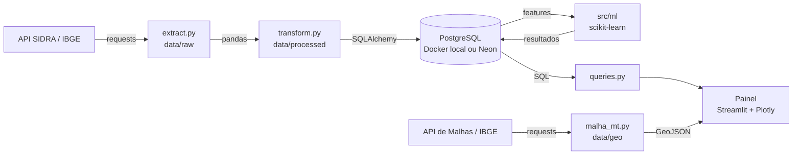
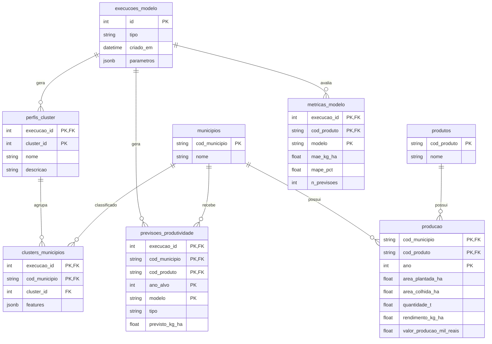

# 🌾 Produção Agrícola de Mato Grosso

Pipeline de dados completo (ETL) com a produção agrícola dos 142 municípios de
Mato Grosso, a partir dos dados oficiais do IBGE, com uma camada de
**Machine Learning**. Os dados são extraídos da API SIDRA, tratados com pandas,
armazenados em PostgreSQL e apresentados em um painel interativo com Streamlit,
que inclui um mapa por município, a **clusterização dos municípios por perfil
produtivo** e a **previsão da produtividade da soja**.

🔗 **Painel online:** [graoseplantiosmt.streamlit.app](https://graoseplantiosmt.streamlit.app/)

## 📊 Destaques dos dados

- A produção de **soja em MT cresceu 2,7 vezes** entre 2010 e 2025, de 18,8
  para 50,2 milhões de toneladas, com a área dobrando e o rendimento subindo
  de ~3.000 para ~3.900 kg/ha.
- **Sorriso** é o maior produtor de soja do estado (2,34 milhões de t em 2025),
  mas responde por apenas **4,7%** do total: a produção é distribuída entre
  muitos municípios de grande porte.
- Em **2024**, a produção de soja caiu 14% mesmo com aumento de área, com
  forte queda no rendimento médio.
- O **algodão** gera cerca de **R$ 19,5 mil por hectare**, quase três vezes a
  soja, e é produzido em menos da metade dos municípios.
- Em peso, o **milho** supera a soja (54,3 × 50,2 milhões de t em 2025), mas
  vale menos da metade: boa parte é a "safrinha", plantada na mesma terra
  após a colheita da soja.
- A clusterização encontrou, sem nenhuma informação geográfica, perfis que
  coincidem com as regiões agrícolas do estado: o **polo soja-milho** do
  Médio-Norte, o **polo do algodão** da Chapada dos Parecis, a **fronteira em
  expansão** do Norte e o **polo canavieiro** de Barra do Bugres e Nova Olímpia.
- Na previsão da produtividade da soja, **nenhum modelo de Machine Learning
  superou o baseline** "média dos 3 anos anteriores" (erro médio de 270 kg/ha).
  Sem dados de clima, o histórico do município já resume quase tudo o que é
  possível prever.

## 🖥️ O painel

| Aba | O que mostra |
|---|---|
| 🏆 Ranking | Maiores municípios produtores da cultura e safra escolhidas, com participação no estado |
| 🗺️ Mapa | Mapa de MT por município: produção, área colhida, rendimento ou valor da produção |
| 📈 Evolução | Série histórica de 2010 a 2025 para o estado ou para um município |
| 🌱 Comparação | Área plantada, valor da produção e valor por hectare de todas as culturas |
| 🔮 Previsões | Mapa dos perfis produtivos, comparação dos modelos de previsão, erro por safra e previsão para 2026 |
| ℹ️ Sobre os dados | Notas metodológicas e cuidados na leitura |

Os indicadores (KPIs) no topo mostram a variação em relação à safra anterior.

## 🏗️ Arquitetura



Os modelos são treinados **fora do painel**, por scripts, e seus resultados
são gravados no banco. O painel apenas lê esses resultados, sem depender do
scikit-learn.

| Etapa | Módulo | O que faz |
|---|---|---|
| Extração | `src/extract.py` | Consulta a API SIDRA (tabela 5457) por cultura e salva o dado bruto |
| Transformação | `src/transform.py` | Converte tipos, trata valores ausentes, pivota para formato largo e valida |
| Carga | `src/load.py` | Grava os cadastros com upsert e a produção com carga completa, em transação |
| Malha territorial | `src/malha_mt.py` | Baixa os contornos dos municípios de MT (GeoJSON), valida e salva localmente |
| Validação geográfica | `src/validar_codigos.py` | Confere se os códigos IBGE da malha correspondem aos do banco |
| Geometria | `src/geo.py` | Ajusta a orientação dos polígonos para o formato exigido pelo Plotly |
| Features | `src/ml/features.py` | Monta as features da clusterização e da previsão |
| Clusterização | `src/ml/clusterizacao.py` | Agrupa os municípios por perfil produtivo (K-Means) e grava no banco |
| Previsão | `src/ml/previsao.py` | Compara baselines e Random Forest com validação temporal e grava as previsões |
| Análise | `src/queries.py` + `sql/` | Consultas SQL parametrizadas usadas pelo painel |
| Visualização | `streamlit_app.py` | Painel com KPIs, ranking, mapa, evolução, comparação e previsões |

## 🛠️ Stack

- **Python** · requests · pandas · NumPy
- **PostgreSQL** em Docker (desenvolvimento local) e no **Neon** (versão online)
- **SQLAlchemy 2.0** (ORM para modelagem, Core para consultas) · psycopg 3
- **scikit-learn** (K-Means, Random Forest) · **Jupyter** para a exploração
- **pytest** para os testes automatizados
- **Streamlit** + **Plotly** para o painel, publicado no **Streamlit Community Cloud**
- **Git/GitHub** para versionamento

## 📁 Estrutura do projeto

```
producao_agricola_mt/
├── data/
│   ├── raw/                     # dados brutos da API (não versionados)
│   ├── processed/               # dados tratados (não versionados)
│   └── geo/                     # malha municipal de MT em GeoJSON (versionada)
├── notebooks/
│   └── exploracao_clusters.ipynb   # escolha do número de grupos (cotovelo e silhueta)
├── sql/                         # consultas de análise e de resultados de ML (.sql)
├── src/
│   ├── config.py                # configurações centrais (códigos IBGE, caminhos, banco)
│   ├── extract.py               # extração
│   ├── transform.py             # transformação e validação
│   ├── models.py                # modelos das tabelas (SQLAlchemy)
│   ├── load.py                  # carga no banco
│   ├── queries.py               # execução das consultas
│   ├── pipeline.py              # executa extração + transformação + carga
│   ├── malha_mt.py              # extração da malha municipal
│   ├── validar_codigos.py       # validação malha × banco
│   ├── geo.py                   # utilidades geográficas
│   └── ml/
│       ├── features.py          # features da clusterização e da previsão
│       ├── clusterizacao.py     # perfis produtivos (K-Means)
│       └── previsao.py          # previsão da produtividade (baselines × Random Forest)
├── tests/
│   └── test_features_previsao.py   # testes contra vazamento de dados
├── streamlit_app.py             # painel Streamlit
├── docker-compose.yml           # PostgreSQL local
├── .env.example                 # modelo das variáveis de ambiente
├── requirements.txt             # dependências do pipeline e do painel
└── requirements-ml.txt          # dependências extras de Machine Learning e testes
```

## 🗄️ Modelo de dados

Modelo estrela simplificado para a produção, mais as tabelas que guardam os
resultados dos modelos.



- A chave primária composta (município + cultura + ano) impede registros
  duplicados diretamente no banco.
- Cada execução de um modelo vira um registro em `execucoes_modelo`, com os
  parâmetros usados em JSON. O painel lê sempre a execução mais recente, e as
  anteriores ficam como histórico. Apagar uma execução remove, em cascata,
  tudo o que ela gerou.
- As previsões ficam em **formato longo** (uma linha por modelo), o que permite
  comparar modelos sem alterar a tabela. O valor real não é duplicado: o
  painel o obtém da tabela `producao`.
- `CHECK constraints` garantem que só tipos válidos sejam gravados
  (`clusterizacao`/`previsao`, `backtest`/`futuro`).

## 🤖 Machine Learning

### 1. Perfis produtivos dos municípios (clusterização)

**Objetivo:** agrupar os municípios pelo que e quanto plantam, sem rótulos
prévios (aprendizado não supervisionado).

**Features** (médias de 2021 a 2025):

| Feature | O que mede |
|---|---|
| Participação de soja, milho, algodão e outras culturas | perfil de cultivo, independente do tamanho |
| Log da área plantada média | tamanho da agricultura (em log, porque a distribuição é muito assimétrica) |
| Índice de produtividade | produtividade relativa à média do estado (1,0 = média de MT) |
| Crescimento da área plantada | expansão entre 2013–2015 e 2023–2025 |

**Método:**
- Municípios com menos de **500 ha** plantados das culturas estudadas formam um
  perfil à parte, **definido por regra**: com áreas tão pequenas, as features
  viram ruído (um único município chegava a formar um grupo sozinho).
- Os demais são padronizados com `StandardScaler` e agrupados com **K-Means**.
- O número de grupos (**k = 5**) foi escolhido no notebook de exploração
  combinando o método do cotovelo, a silhueta, o tamanho dos grupos e a
  interpretação agronômica. A silhueta era maior com k = 2 ou 3, mas porque o
  algoritmo apenas separava alguns municípios atípicos e deixava mais de 120
  em um único grupo; a partir de k = 6, surgiam grupos de um só município.
- Os números dos grupos gerados pelo K-Means são arbitrários. Por isso, cada
  grupo recebe o nome **a partir das suas características** (ex.: o de maior
  participação de "outras culturas" é o polo canavieiro), e o script falha de
  propósito se algum perfil deixar de ser claro.

**Resultado** (silhueta média de 0,287):

| Perfil | Municípios | Características |
|---|---|---|
| Polo soja-milho consolidado | 65 | soja 60% + milho 35%, áreas grandes |
| Fronteira agrícola em expansão | 40 | soja 73%, área multiplicada por ~4,9 em 10 anos |
| Polo do algodão | 16 | 15% de algodão, as maiores áreas do estado |
| Polo canavieiro | 7 | 91% em outras culturas (cana-de-açúcar) |
| Agricultura incipiente, com foco em milho | 6 | milho 65%, áreas pequenas |
| Lavouras pouco expressivas (regra) | 7 | menos de 500 ha plantados |

### 2. Previsão da produtividade da soja (regressão)

**Objetivo:** estimar a produtividade (kg/ha) da próxima safra em cada
município.

**Features:** produtividade dos 3 anos anteriores, média desses 3 anos e área
plantada no ano anterior. Municípios com menos de 1.000 ha de soja colhida são
excluídos, porque a produtividade em áreas pequenas é instável.

**Cuidados contra vazamento de dados:**
- Toda feature do ano *t* usa apenas informação de anos anteriores. A média dos
  3 anos é calculada a partir das defasagens, o que impede, por construção,
  que o próprio ano entre no cálculo.
- Anos sem registro viram valores ausentes em uma grade completa município ×
  ano, para que o "ano anterior" nunca seja, na verdade, dois anos antes.
- Esses comportamentos são verificados por **testes automatizados** (pytest).

**Validação temporal (walk-forward):** cada safra de 2020 a 2025 é prevista
com um modelo treinado apenas com as safras anteriores a ela, como aconteceria
na prática. Todos os modelos são avaliados no mesmo conjunto de 669 previsões.

**Resultado:**

| Modelo | Erro médio (MAE) | Erro médio (%) |
|---|---|---|
| **Média dos 3 anos anteriores (baseline)** | **270 kg/ha** | **7,8%** |
| Random Forest (valor direto) | 289 kg/ha | 8,4% |
| Random Forest (variação sobre a média de 3 anos) | 293 kg/ha | 8,6% |
| Repetir o ano anterior (baseline) | 341 kg/ha | 9,9% |

**Conclusão:** o Random Forest só superou o baseline em anos sem choques
(2022 e 2023) e errou mais em 2024 e 2025, ano de quebra de safra e ano de
recuperação. O que faz uma safra fugir da média (chuva, veranico, calor) não
está nas features, que descrevem apenas o histórico de cada município. O
modelo acabava aprendendo ruído.

Por isso, a previsão publicada para 2026 (120 municípios) usa a **média dos 3
anos anteriores**. A escolha não é manual: o script publica automaticamente o
modelo de menor erro na validação, o que permite que um modelo melhor assuma
o lugar se novas features (como dados de clima) forem incluídas.

## 🚀 Como executar localmente

**Pré-requisitos:** Python 3.12+, Docker com Docker Compose e Git.

**1. Clonar o repositório**
```bash
git clone https://github.com/oneriodev/producao_agricola_mt.git
cd producao_agricola_mt
```

**2. Criar o ambiente virtual e instalar as dependências**
```bash
python3 -m venv .venv
source .venv/bin/activate        # Linux/Mac
# .venv\Scripts\Activate.ps1     # Windows (PowerShell)
pip install -r requirements.txt
```

**3. Configurar as variáveis de ambiente**
```bash
cp .env.example .env             # Linux/Mac
# copy .env.example .env         # Windows
```
Edite o `.env` e defina uma senha para o banco.

> Se você já tem um PostgreSQL instalado usando a porta 5432, troque
> `POSTGRES_PORT` no `.env` (por exemplo, para `5433`).

**4. Subir o PostgreSQL**
```bash
docker compose up -d
```
O banco fica acessível apenas a partir da própria máquina (`127.0.0.1`).

**5. Rodar o pipeline** (extração, transformação e carga)
```bash
python -m src.pipeline
```

**6. (Opcional) Rodar os modelos de Machine Learning**
```bash
pip install -r requirements-ml.txt
python -m pytest -v                  # testes contra vazamento de dados
python -m src.ml.clusterizacao       # perfis produtivos
python -m src.ml.previsao            # previsão da produtividade
```
Sem esta etapa, o painel funciona normalmente e a aba Previsões informa que
os resultados ainda não foram gerados.

**7. Abrir o painel**
```bash
streamlit run streamlit_app.py
```
O painel abre em `http://localhost:8501`.

## 🌐 Deploy

A versão online usa o mesmo código, com dois serviços gratuitos:

- **Banco de dados:** PostgreSQL gerenciado no [Neon](https://neon.tech), com
  conexão criptografada (SSL).
- **Painel:** [Streamlit Community Cloud](https://streamlit.io/cloud), que lê
  o repositório do GitHub e publica o `streamlit_app.py`.

A conexão é definida pela variável de ambiente `DATABASE_URL`. Quando ela
existe, o projeto usa o banco na nuvem; quando não existe, monta a conexão
com o PostgreSQL local a partir das variáveis `POSTGRES_*` do `.env`.

Para publicar:
1. Crie um banco no Neon e copie a connection string.
2. Carregue os dados rodando o pipeline com a variável definida:
```bash
   export DATABASE_URL="postgresql://..."      # Linux/Mac
   # $env:DATABASE_URL = "postgresql://..."    # Windows (PowerShell)
   python -m src.pipeline
```
3. Com a mesma variável definida, gere os resultados dos modelos:
```bash
   python -m src.ml.clusterizacao
   python -m src.ml.previsao
```
4. No Streamlit Cloud, publique o repositório apontando para `streamlit_app.py`
   e cadastre a `DATABASE_URL` em **Settings → Secrets**:
```toml
   DATABASE_URL = "postgresql://..."
```

A connection string contém a senha do banco: ela nunca é gravada no código
nem enviada ao repositório. O Streamlit Cloud instala apenas o
`requirements.txt`: as bibliotecas de Machine Learning ficam no
`requirements-ml.txt`, porque o treino acontece fora do painel.

## 🧠 Decisões técnicas

**Pipeline e banco**

- **Dado bruto preservado:** a extração salva a resposta da API sem alterações.
  Se a transformação mudar, basta reprocessar, sem consultar a API de novo.
- **Tratamento de valores ausentes seguindo o padrão do IBGE:** `-` significa
  zero e vira `0`; `...` significa dado não disponível e vira `NULL`.
  Transformar tudo em zero distorceria médias e séries históricas.
- **Validação na transformação:** o pipeline confere o número de linhas,
  duplicatas e valores negativos, e interrompe a execução se algo falhar.
- **Carga idempotente:** os cadastros (municípios e culturas) são gravados com
  *upsert* (`INSERT ... ON CONFLICT DO UPDATE`), e a produção é esvaziada e
  recarregada, tudo dentro de uma transação. Rodar o pipeline várias vezes
  produz sempre o mesmo resultado, e os resultados dos modelos, que dependem
  dos cadastros por chave estrangeira, são preservados.
- **SQL parametrizado:** os filtros do painel são passados como parâmetros,
  nunca concatenados no texto do SQL, o que evita SQL injection.
- **Rendimento como média ponderada:** o rendimento do estado é calculado
  como produção total ÷ área colhida total, e não como média simples dos
  municípios, que daria o mesmo peso a municípios pequenos e grandes.
- **Configuração centralizada:** códigos do IBGE, caminhos e credenciais
  ficam em `config.py` e em variáveis de ambiente.
- **Mesmo código local e na nuvem:** a troca entre o banco local e o Neon é
  feita só pela variável `DATABASE_URL`, sem alterar o código. O pool de
  conexões testa cada conexão antes de usar (`pool_pre_ping`), porque o
  banco na nuvem encerra conexões ociosas.

**Mapa**

- **Validar antes de visualizar:** os códigos da malha e do banco são
  comparados com operações de conjuntos, o que encontrou um município sem
  contorno na malha (ver Limitações). O painel exibe esse aviso automaticamente.
- **NULL não é zero:** as consultas partem da tabela de municípios com
  `LEFT JOIN`, com os filtros na cláusula `ON`, e municípios sem dado aparecem
  em cinza, e não como "produção zero".
- **Orientação dos polígonos:** o GeoJSON do IBGE segue o padrão RFC 7946
  (sentido anti-horário), mas o Plotly espera o sentido horário. O sentido de
  cada contorno é identificado pelo sinal da área calculada com a fórmula do
  laço (*shoelace*) e invertido quando necessário.

**Machine Learning**

- **Treino fora do painel:** os modelos rodam em scripts e gravam os
  resultados no banco. O painel publicado fica leve e não depende do
  scikit-learn.
- **Exploração separada da produção:** as decisões (número de grupos, área
  mínima) foram tomadas em um notebook; o script reproduz essas decisões de
  forma automática e reprodutível (`random_state` fixo).
- **Baseline antes de qualquer modelo:** todo modelo é comparado com regras
  simples, e o publicado é escolhido pelo menor erro na validação temporal.
- **Testes contra vazamento de dados** nas features de previsão.
- **Falha controlada no painel:** se as tabelas de resultados não existirem no
  banco, a aba Previsões mostra um aviso, sem derrubar o resto do painel. Só o
  erro "tabela inexistente" é tratado; qualquer outro continua visível.
- **Datas em UTC:** o banco guarda a hora em UTC, e o painel converte para o
  horário de Cuiabá apenas na exibição.

## ⚠️ Limitações e cuidados na leitura

- Os dados de **2025 são preliminares** e podem ser revisados pelo IBGE. A
  previsão para 2026 se apoia neles.
- O **valor da produção está em reais correntes**, sem correção pela inflação.
- A **área plantada** pode ser contada mais de uma vez quando há cultivos
  sucessivos na mesma terra (ex.: milho safrinha após a soja).
- **Boa Esperança do Norte** é um município recém-criado e só possui dados
  a partir de 2025. Ele não consta na malha do IBGE utilizada no mapa e fica
  fora da clusterização e da previsão, por não ter histórico. Em 2025, o
  contorno de Sorriso no mapa ainda inclui a área do novo município.
- Os **perfis produtivos** são agrupamentos estatísticos para análise, e não
  uma classificação oficial.
- A **previsão de produtividade** não considera clima: ela não antecipa
  quebras de safra como a de 2024.
- No plano gratuito do Neon, o banco é suspenso quando fica sem uso. O
  **primeiro acesso** ao painel depois de um tempo parado pode levar alguns
  segundos a mais.

## 🔭 Próximos passos

- Incluir **dados de clima** (chuva e temperatura por safra) como features da
  previsão, a informação que hoje falta aos modelos.
- Estender a previsão para **milho e algodão**.
- Adotar **Alembic** para versionar as alterações de estrutura do banco.
- Rodar os testes automaticamente a cada *push* com **GitHub Actions**.

## 📚 Fontes dos dados

- IBGE – Produção Agrícola Municipal (PAM), tabela 5457:
  [sidra.ibge.gov.br/tabela/5457](https://sidra.ibge.gov.br/tabela/5457)
- IBGE – API de Malhas Territoriais (contornos dos municípios):
  [servicodados.ibge.gov.br/api/docs/malhas](https://servicodados.ibge.gov.br/api/docs/malhas?versao=3)

## 👤 Autor

**Onerio** – estudante de Engenharia de Software, com foco em Python e dados.

[GitHub](https://github.com/oneriodev) · [LinkedIn](https://www.linkedin.com/in/onerio-ramos)
